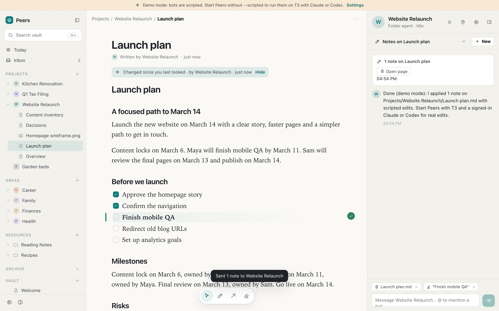
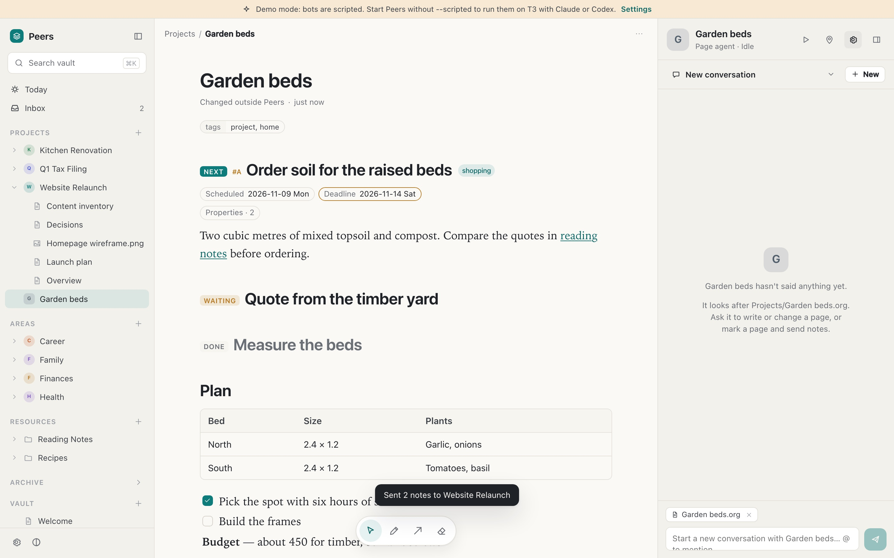
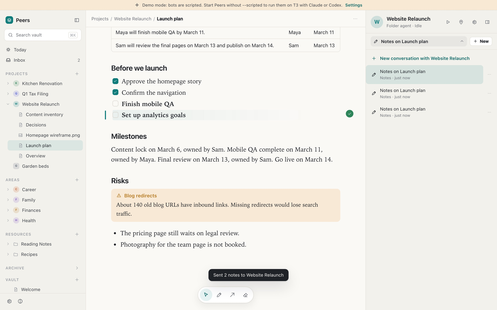

# Peers

**A notes vault where any folder can have its own AI agent you talk to.**

Peers opens a folder of notes (Markdown with Obsidian conventions, or Emacs Org) in a web app.
Any folder, or a single page, can have an agent that looks after it: it reads what is there,
keeps it current, and takes instructions from you in a chat or from marks you draw on the
page. Agents read the whole vault and each other's conversations, and `@Name` in any chat sends
a message to another agent. Agents are Claude Code or Codex sessions on
[T3 Code](https://t3.codes), signed in with their own accounts, and everything runs in one
container that sees only your notes.



| An Org project with its own agent | Several conversations with one agent |
| --- | --- |
|  |  |

## What you can do

- **Talk to the agent of a folder.** Open a project, an area, a client folder or a wiki
  section; its agent is in the right pane. Start as many conversations with it as you like.
- **Mark a page instead of typing.** Select text, circle a paragraph, draw an arrow, add a
  short instruction, and send. The agent edits the page; each note shows whether it was
  applied or answered.
- **See what changed since you last looked.** Changed blocks are marked on the page, the tree
  shows a dot, and Today lists the pages, with who changed them.
- **Mention another agent.** `@Finances can we afford the oven?` sent from the Kitchen chat
  reaches the Finances agent too, in a conversation that links back.
- **Let agents work on a schedule** or when files change, with guards that stop agents from
  waking each other in a loop.
- **Use it from your phone**, as an installable web app, over HTTPS through Tailscale Serve.

## Any organisation, PARA included

Which folders have agents is written in a small layout file in the vault,
`.peers/layout.json`. Peers suggests one when it first opens a vault:

- **PARA**, when it finds Projects or Areas folders: every project and area folder, or single
  project file, gets an agent; the archive's agents are paused.
- **One agent per top-level folder**, for anything else.
- **Wiki**: only the vault agent, and you add more by hand.

Single-file projects (Org repositories often keep one `.org` file per project) get a page
agent and nothing is moved. A folder's front page (`index`, `README`, `main`, `Overview`, or
`<folder>/<folder>.md`) opens with the folder and names its agent. Generated folders can be
marked read-only and tool folders hidden. Right-click any folder or page to give it an agent.

## Install

Peers runs in a container. You need:

- macOS 26 or later on Apple silicon with Apple's [`container`](https://github.com/apple/container)
  tool (Docker and Podman support is planned);
- Node.js 22.13 or later for the `peers` command;
- a Claude (Claude Code) or ChatGPT (Codex) account for the agents.

```bash
git clone https://github.com/kdpa-llc/peers.git
cd peers
npm install
npm run peers -- up ~/"Peers Vault" --demo     # builds the image, starts the container, prints a link
```

Open the printed link, go to **Settings → Bots**, and sign the agents in: Peers shows the
Claude sign-in link and takes back its code, and shows Codex's device code. The sign-ins are
kept in the container's state, separate from your own Claude Code and Codex.

To try it without T3 or any account: `npm run peers -- up /tmp/try --demo --scripted`.

`peers down` stops the container; the vault and its state stay on your computer.
`peers status`, `peers logs` and `peers pair` (a one-time code for another device) do what they
say.

### Installing with an AI agent

Point your agent at this repository and ask it to install Peers. The steps are
non-interactive up to the sign-ins, which a person finishes in the browser:

1. Check the requirements above (`container system status` must succeed).
2. `git clone https://github.com/kdpa-llc/peers.git && cd peers && npm install`
3. `npm run peers -- up "<vault folder>"` (add `--demo` for an empty folder).
4. Give the person the printed `http://127.0.0.1:4777/?pair=…` link and ask them to sign the
   agents in under Settings → Bots.

### From your phone

Run `tailscale serve --bg 4777` once, start with
`npm run peers -- up "<vault>" --origin https://<mac>.<tailnet>.ts.net`, open that address on
the phone and type the code from `npm run peers -- pair`. Add it to the Home Screen.

## How it works

- **The container** (`container/Containerfile`): Node, T3's Linux build checked against its
  release checksums, Claude Code, Codex and the app, running as an unprivileged user. It
  mounts only the vault folder and its own state folder, and publishes the web port on the
  host's loopback.
- **T3** runs headless inside it with its own data and the agents' own sign-ins. The vault is
  one T3 project; each conversation is a T3 thread; each agent's first message carries a brief
  saying what it looks after, where its memory is, and the vault's rules.
- **The web app** is plain TypeScript modules with no framework or bundler, and its own
  Markdown and Org parsers that never turn vault content into HTML.
- **State** (what you have seen, notes, conversations as text, the T3 data) lives outside the
  vault; the vault gets only `.peers/` with the layout and each agent's definition and memory.

Design: [`docs/design/`](docs/design/README.md). Decisions: [`docs/adr/`](docs/adr/).

## Development

```bash
npm install
npm test                  # unit and contract tests, deterministic (demo engine, fixed clock)
npm run typecheck         # server and web client
npm run build             # compiled JavaScript in dist/
npm run test:package      # pack, install in a clean folder, run the installed command
npm run test:e2e          # browser journey in desktop Chromium and phone WebKit (needs playwright-core)
npm run dev -- /tmp/vault --demo --scripted   # the server in this process, no container
python3 scripts/validate-schemas.py           # needs: pip install jsonschema
```

See [CONTRIBUTING.md](CONTRIBUTING.md).

## Security

Peers binds to loopback, pairs devices with one-time codes, checks Host and Origin on every
request, serves vault files sandboxed, and never renders vault content as HTML. Agents can do
whatever Claude Code and Codex can do inside the container, and there is no Undo: keep the
vault in Git, Time Machine or a sync tool with versions. Details and reporting:
[SECURITY.md](SECURITY.md).

## License

MIT. See [LICENSE](LICENSE).
