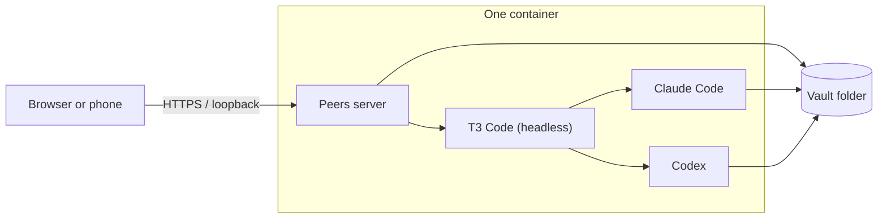

<div align="center">

# 👥 Peers

**A notes vault where any folder can have its own AI agent you talk to**

[![License: MIT][license-badge]][license]
[![Node][node-badge]][nodejs]
[![Runtime deps][deps-badge]][package-json]
[![Runs on T3][t3-badge]][t3]
[![Container][container-badge]][apple-container]

[![CI][ci-badge]][ci-workflow]
[![CodeQL][codeql-badge]][codeql-workflow]

[![GitHub Stars][stars-badge]][stargazers]
[![GitHub Forks][forks-badge]][network]
[![GitHub Issues][issues-badge]][repo-issues]
[![GitHub Last Commit][commit-badge]][commits]
[![PRs Welcome][prs-badge]][contributing]

[Quick Start](#-quick-start) •
[Features](#-features) •
[Usage](#-usage) •
[Configuration](#-configuration) •
[Architecture](#️-architecture) •
[Security](#-security) •
[FAQ](#-faq) •
[Contributing](#-contributing)

</div>

---

## 📑 Table of Contents

- [What is Peers?](#what-is-peers)
- [✨ Features](#-features)
- [🚀 Quick Start](#-quick-start)
- [🎯 Usage](#-usage)
- [🔧 Configuration](#-configuration)
- [🏗️ Architecture](#️-architecture)
- [🔒 Security](#-security)
- [❓ FAQ](#-faq)
- [🧪 Testing](#-testing)
- [🤝 Contributing](#-contributing)

---

## What is Peers?

Peers opens a folder of notes, **Markdown with Obsidian conventions or Emacs Org**, in a web app where **any folder, or a single page, can have its own AI agent**. The agent reads what is there, keeps it current, and takes instructions from you in a chat or from marks you draw on the page. Agents read the whole vault and each other's conversations, and `@Name` in any chat sends a message to another agent.

Agents are Claude Code or Codex sessions on [T3 Code][t3], signed in with their own accounts, and **everything runs in one container** that sees only your notes.


### 🆚 How it compares

| | Peers | A chat assistant | An AI editor |
| --- | --- | --- | --- |
| **Who writes** | Agents write, you steer | You copy answers in | You write, AI suggests |
| **Scope** | One agent per folder or page, as many as you like | One conversation | The open file |
| **Instructions** | Chat, or marks drawn on the page | Chat | Prompts in the editor |
| **Your files** | A plain folder that opens in Obsidian or Emacs | Stay in the chat | Stay yours |
| **Isolation** | One container that sees only the vault | Hosted | Your whole machine |

## ✨ Features

- 📁 **Agents per folder or page** — a layout file says which; PARA (Projects, Areas, Resources, Archive), one agent per top-level folder, and wiki are presets Peers suggests
- 🖊️ **Mark a page instead of typing** — select text, circle a paragraph or draw an arrow, add a short instruction, send; each note shows whether it was applied or answered
- 💬 **Several conversations per agent** — start as many as you like; notes and triggers get their own
- 📣 **@mentions** — `@Finances can we afford it?` from any chat reaches the Finances agent too, in a conversation that links back
- 👀 **Changed since you last looked** — changed blocks marked on the page, a dot in the tree, and a list on Today
- 📝 **Markdown and Org** — wikilinks, embeds, callouts, front matter; Org task states, priorities, tags, drawers and planning lines; images and PDFs
- ⏰ **Schedules and file triggers** — with guards that stop agents from waking each other in a loop
- 🔐 **Separate sign-ins** — the agents' Claude Code and Codex accounts live in the container, apart from your own
- 📱 **Phone and desktop** — an installable web app; HTTPS from the phone through Tailscale Serve, with device pairing
- 🌗 **Day and night themes**, keyboard shortcuts and a ⌘K palette

## 🚀 Quick Start

### Prerequisites

- macOS 26 or later on Apple silicon with Apple's [`container`][apple-container] tool (Docker and Podman are planned)
- Node.js 22.13 or later
- A Claude (Claude Code) or ChatGPT (Codex) account for the agents

### 1. Install

```bash
git clone https://github.com/kdpa-llc/peers.git
cd peers
npm install
```

### 2. Start

```bash
npm run peers -- up ~/"Peers Vault" --demo
```

The first run builds the container image (a few minutes). Peers prints a one-time link:

```
Started peers-vault: vault ~/Peers Vault, state ~/Library/Application Support/Peers/box
Agents: 10 (embedded T3 · claude · claude-sonnet-5-5)

Open:   http://127.0.0.1:4777/?pair=XXXXXX
```

### 3. Sign the agents in

Open the link, go to **Settings → Bots**, and sign in Claude, Codex or both. Peers shows the Claude sign-in link and takes back its code, and shows Codex's device code.

> 🎉 **You're ready.** Open a project, talk to its agent, or mark a paragraph and send a note.

Want to look around first, without T3 or any account?

```bash
npm run peers -- up /tmp/try --demo --scripted
```

### 🤖 Installing with an AI agent

Point your agent at this repository and ask it to install Peers. The steps in [AGENTS.md](AGENTS.md) are non-interactive up to the sign-ins, which a person finishes in the browser.

## 🎯 Usage

| Command | What it does |
| --- | --- |
| `peers up [dir]` | Start Peers in a container for this vault folder (default `~/Peers Vault`) |
| `peers down` | Stop the container; the vault and its state stay |
| `peers status` / `peers logs` | What the container is doing, and its output |
| `peers pair` | A one-time code to pair a phone or another browser |
| `peers login claude\|codex` | Sign the agents in from a terminal (or use Settings) |
| `peers build` | Rebuild the container image |
| `peers serve [dir]` | Run the server in this process (inside the container, development) |

In a checkout, run them as `npm run peers -- <command>`.

**In the app**

- **Talk to a folder's agent** — open any page; its agent is in the right pane. **New** starts another conversation.
- **Give any folder or page an agent** — right-click it in the tree. **Remove agent** keeps its memory and conversations for later.
- **Send notes** — press `P` for the pen or `A` for an arrow, mark the page, type what you want, press Enter.
- **Mention** — type `@` in any chat to pick another agent.
- **Today** — replies you have not read, failed runs, pages changed since you looked, and what is coming up.

**From your phone**

```bash
tailscale serve --bg 4777
npm run peers -- up ~/"Peers Vault" --origin https://<mac>.<tailnet>.ts.net
npm run peers -- pair     # type the code on the phone
```

## 🔧 Configuration

### Layout

Which folders and pages have agents lives in the vault, in `.peers/layout.json`. Peers writes a suggested one on first open; edit it in **Settings → Layout** or by hand:

```json
{
  "preset": "para",
  "agents": ["Projects/*", "Areas/*", "projects/*.org"],
  "paused": ["Archive/**"],
  "inbox": "Inbox",
  "archive": "Archive",
  "readonly": ["views/**"],
  "hidden": ["raw", "scripts"],
  "rules": ["AGENTS.md"]
}
```

`*` matches within one folder and `**` any depth; patterns ending in `.md` or `.org` mean single pages. A folder's front page (`index`, `README`, `main`, `Overview`, or `<folder>/<folder>.md`) opens with the folder and names its agent. Schema: [`docs/specs/layout.schema.json`](docs/specs/layout.schema.json).

### Command-Line Options

| Option | Default | Description |
| --- | --- | --- |
| `--demo` | | Copy the demo vault into an empty folder |
| `--scripted` | | Scripted demo agents: no T3, no sign-in, no model |
| `--origin <url>` | | The HTTPS address phones use |
| `--port <n>` | `4777` | Port on this computer |
| `--build` | | Rebuild the container image first |
| `--memory <size>` / `--cpus <n>` | `4G` / `4` | Container resources |

### Environment Variables

| Variable | Description |
| --- | --- |
| `PEERS_VAULT` | Default vault folder for `up` and `serve` |
| `PEERS_BOX_STATE` | Where the container's state lives on the host (default `~/Library/Application Support/Peers/box`) |
| `PEERS_CONTAINER_BIN` | The container command (default `container`) |
| `PEERS_PORT` | Port for `peers serve` |
| `PEERS_STATE_DIR` / `PEERS_AGENT_HOMES` | State and the agents' sign-in folders for `peers serve` |
| `PEERS_T3_BIN` | The `t3` executable for `peers serve` (set in the image) |
| `PEERS_ENGINE=demo` | Same as `--scripted` |

## 🏗️ Architecture



- **The container** (`container/Containerfile`) holds Node, T3's Linux build checked against its release checksums, Claude Code, Codex and the app, running as an unprivileged user. It mounts only the vault folder and its own state folder.
- **T3** runs headless inside it with its own data and the agents' own sign-ins. The vault is one T3 project; each conversation is a T3 thread; each agent's first message carries a brief saying what it looks after, where its memory is, and the vault's rules.
- **The web app** is plain TypeScript modules with no framework or bundler, with its own Markdown and Org parsers that never turn vault content into HTML.
- **State** (what you have seen, notes, conversations as text, T3's data) lives outside the vault; the vault gets only `.peers/` with the layout and each agent's definition and memory.

Design: [`docs/design/`](docs/design/README.md). Decisions: [`docs/adr/`](docs/adr/). Numbered rules: [`docs/specs/CONTRACT_TESTS.md`](docs/specs/CONTRACT_TESTS.md).

## 🔒 Security

- The server binds to loopback; the container publishes its port on the host's loopback only
- Devices pair with single-use codes; sessions are hashed, `HttpOnly`, `SameSite=Strict` cookies you can revoke
- Every write needs an `X-Peers` header and a matching `Origin`; the `Host` header is checked (DNS rebinding)
- Vault content is never rendered as HTML, and raw files are served sandboxed
- Agents can do what Claude Code and Codex can do inside the container, and nothing outside it
- There is no Undo: keep the vault in Git, Time Machine or a sync tool with versions

See [SECURITY.md][security] to report a vulnerability.

## ❓ FAQ

<details>
<summary><strong>Q: Do I need to organise my notes with PARA?</strong></summary>
<p>No. PARA is one layout Peers recognises. A wiki, a list of clients or courses, or anything else works: give agents to the folders you want, or edit <code>.peers/layout.json</code>.</p>
</details>

<details>
<summary><strong>Q: Does it work with my existing Obsidian vault or Emacs Org files?</strong></summary>
<p>Yes. Peers reads the folder as it is and adds only <code>.peers/</code>. Org repositories that keep each project in a single <code>.org</code> file get one agent per file, and nothing is moved.</p>
</details>

<details>
<summary><strong>Q: Which AI models does it use?</strong></summary>
<p>Claude Code and Codex, through T3, with any model they offer (Settings lists them). The agents use your Claude or ChatGPT plan; Peers does not meter cost.</p>
</details>

<details>
<summary><strong>Q: Will the agents' conversations show up in my own Claude Code or Codex?</strong></summary>
<p>No. The agents sign in with their own config folders inside the container.</p>
</details>

<details>
<summary><strong>Q: Can the agents see the rest of my computer?</strong></summary>
<p>No. The container mounts only the vault folder and Peers' state folder. It does have internet access, which the agents need.</p>
</details>

<details>
<summary><strong>Q: Can I undo an agent's change?</strong></summary>
<p>Peers shows every change since you last looked, but keeps no history of its own. Keep the vault in Git, Time Machine or a sync tool with versions.</p>
</details>

<details>
<summary><strong>Q: Does it run on Linux or Windows?</strong></summary>
<p>Not yet: it needs Apple's container tool today. Docker and Podman support is planned.</p>
</details>

<details>
<summary><strong>Q: Where can I get help?</strong></summary>
<p>Open an <a href="https://github.com/kdpa-llc/peers/issues">issue on GitHub</a>.</p>
</details>

**More:** See [CONTRIBUTING.md][contributing], [SECURITY.md][security], [CHANGELOG.md][changelog]

## 🧪 Testing

```bash
npm test                  # unit and contract tests, deterministic (demo agents, fixed clock)
npm run typecheck         # server and web client
npm run build             # compiled JavaScript in dist/
npm run test:package      # pack, install in a clean folder, run the installed command
npm run test:e2e          # browser journey in desktop Chromium and phone WebKit (needs playwright-core)
python3 scripts/validate-schemas.py   # needs: pip install jsonschema
```

## 🤝 Contributing

Contributions welcome! See [CONTRIBUTING.md][contributing] for detailed guidelines.

**Quick start:**

1. Fork and clone the repository
2. Create your feature branch (`git checkout -b feature/amazing-feature`)
3. Make changes and add tests
4. Commit (`git commit -m 'Add amazing feature'`)
5. Push (`git push origin feature/amazing-feature`)
6. Open a Pull Request

This project follows a [Code of Conduct][code-of-conduct].

## 🔗 Complementary Projects

**Give your agents more to work with:**

### [Local Skills MCP][local-skills-mcp]

**Expert skills from your local filesystem, for any MCP client**

Write skills once and use them across Claude Code, Claude Desktop and other MCP clients, loaded only when needed.

### [MCP Compression Proxy][mcp-compression-proxy]

**More MCP tools, less context overhead**

One local gateway for many MCP servers, with progressive tool discovery so agents load only the schemas they use.

## 💖 Support This Project

If you find Peers useful, please consider supporting its development!

<div align="center">

[![GitHub Sponsors][sponsor-github-badge]][sponsor-github]
[![Buy Me A Coffee][sponsor-coffee-badge]][sponsor-coffee]
[![PayPal][sponsor-paypal-badge]][sponsor-paypal]

</div>

**Ways to support:**

- ⭐ [Star this repository][stargazers]
- 💰 Sponsor via the badges above
- 🐛 [Report bugs and suggest features][repo-issues]
- 📝 [Contribute code or documentation][contributing]

## 📄 License

MIT License - see [LICENSE][license-file] file. **Copyright © 2026 KDPA LLC**

## 🙏 Acknowledgments

Built on [T3 Code][t3], [Claude Code][claude-code] and [Codex][codex] • PDFs by [PDF.js][pdfjs] • Inspired by [Obsidian][obsidian], [Org mode][org-mode] and the [PARA method][para]

---

<div align="center">

**[⬆ Back to Top](#-peers)**

Made with ❤️ by KDPA

</div>

<!-- Reference Links -->
<!-- Badges - Top of README -->

[license-badge]: https://img.shields.io/badge/License-MIT-yellow.svg
[license]: https://opensource.org/licenses/MIT
[node-badge]: https://img.shields.io/badge/node-%3E%3D22.13-brightgreen.svg
[nodejs]: https://nodejs.org/
[deps-badge]: https://img.shields.io/badge/runtime%20deps-1-blue.svg
[package-json]: package.json
[t3-badge]: https://img.shields.io/badge/runs%20on-T3%20Code-black.svg
[t3]: https://github.com/pingdotgg/t3code
[container-badge]: https://img.shields.io/badge/container-Apple%20container-lightgrey.svg?logo=apple
[apple-container]: https://github.com/apple/container

<!-- CI/CD Badges -->

[ci-badge]: https://github.com/kdpa-llc/peers/actions/workflows/ci.yml/badge.svg
[ci-workflow]: https://github.com/kdpa-llc/peers/actions/workflows/ci.yml
[codeql-badge]: https://github.com/kdpa-llc/peers/actions/workflows/codeql.yml/badge.svg
[codeql-workflow]: https://github.com/kdpa-llc/peers/actions/workflows/codeql.yml

<!-- GitHub Badges -->

[stars-badge]: https://img.shields.io/github/stars/kdpa-llc/peers?style=social
[stargazers]: https://github.com/kdpa-llc/peers/stargazers
[forks-badge]: https://img.shields.io/github/forks/kdpa-llc/peers?style=social
[network]: https://github.com/kdpa-llc/peers/network/members
[issues-badge]: https://img.shields.io/github/issues/kdpa-llc/peers
[repo-issues]: https://github.com/kdpa-llc/peers/issues
[commit-badge]: https://img.shields.io/github/last-commit/kdpa-llc/peers
[commits]: https://github.com/kdpa-llc/peers/commits/main
[prs-badge]: https://img.shields.io/badge/PRs-welcome-brightgreen.svg

<!-- Repository Links -->

[repo]: https://github.com/kdpa-llc/peers
[pulls]: https://github.com/kdpa-llc/peers/pulls

<!-- Documentation Links -->

[contributing]: CONTRIBUTING.md
[security]: SECURITY.md
[changelog]: CHANGELOG.md
[code-of-conduct]: CODE_OF_CONDUCT.md
[license-file]: LICENSE

<!-- Sponsorship Links -->

[sponsor-github-badge]: https://img.shields.io/badge/Sponsor-GitHub%20Sponsors-ea4aaa?logo=github
[sponsor-github]: https://github.com/sponsors/moscaverd
[sponsor-coffee-badge]: https://img.shields.io/badge/Buy%20Me%20A%20Coffee-support-yellow?logo=buy-me-a-coffee
[sponsor-coffee]: https://buymeacoffee.com/moscaverd
[sponsor-paypal-badge]: https://img.shields.io/badge/PayPal-donate-blue?logo=paypal
[sponsor-paypal]: https://paypal.me/moscaverd

<!-- Complementary Projects -->

[local-skills-mcp]: https://github.com/kdpa-llc/local-skills-mcp
[mcp-compression-proxy]: https://github.com/kdpa-llc/mcp-compression-proxy

<!-- Acknowledgments -->

[claude-code]: https://www.anthropic.com/claude-code
[codex]: https://openai.com/codex
[pdfjs]: https://mozilla.github.io/pdf.js/
[obsidian]: https://obsidian.md
[org-mode]: https://orgmode.org
[para]: https://fortelabs.com/blog/para/
