# Peers design

Peers is a notes vault (Markdown or Emacs Org) where any folder or page can have an agent that
writes its pages and takes instructions from your marks and messages.

| Document | What it covers |
| --- | --- |
| [PRODUCT.md](PRODUCT.md) | Product and UX: layout, tools, agents, flows, look, phone, desktop app |
| [TECHNICAL.md](TECHNICAL.md) | Architecture, data, API, security, tests |
| [BENCHMARK.md](BENCHMARK.md) | What we take from Obsidian, OpenClaw, ChatGPT Canvas, tldraw, Codex, Notion, Linear and others |

Decisions: [ADR 0001](../adr/0001-a-notes-vault-with-agents.md) (the product),
[0002](../adr/0002-plain-module-web-client.md) (plain module client, own parsers),
[0003](../adr/0003-agents-on-embedded-t3.md) (agents on an embedded T3),
[0004](../adr/0004-backend-in-a-container.md) (one container),
[0005](../adr/0005-folder-agents-and-layouts.md) (any folder or page can have an agent).

## Screenshots

From the browser journey (`npm run test:e2e`): the demo vault with the demo engine.

| A page changed since you last looked, with an applied note | Two notes queued for one send |
| --- | --- |
| 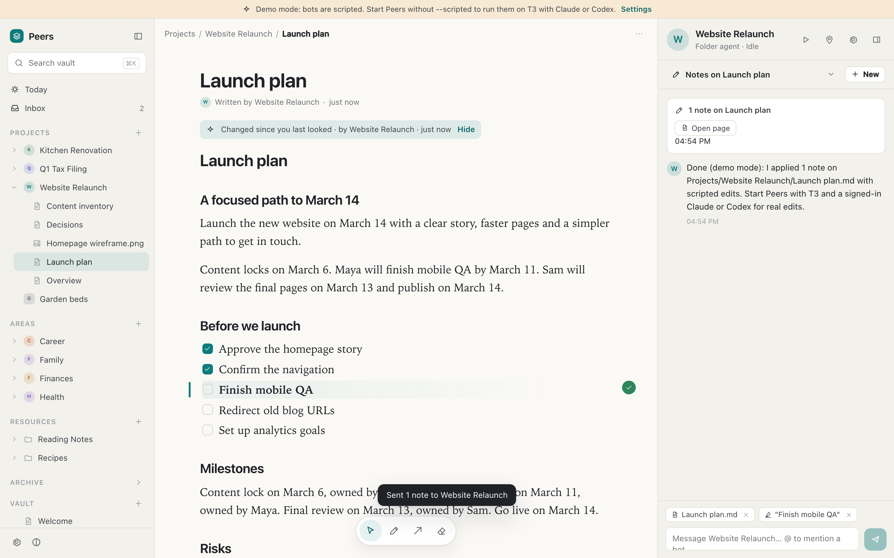 | 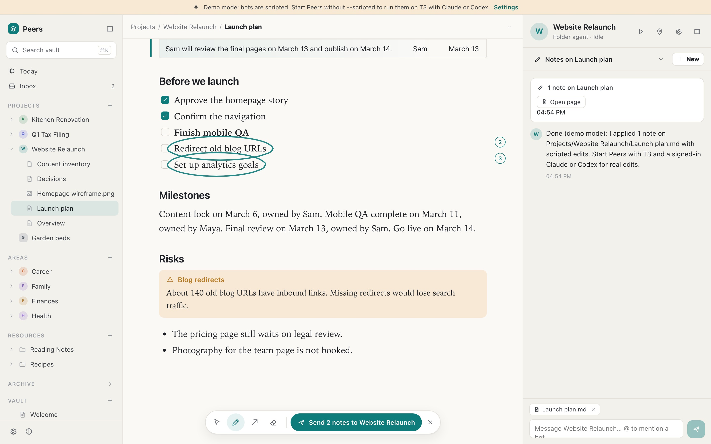 |

| An Org project with its own agent | Conversations of one agent |
| --- | --- |
| 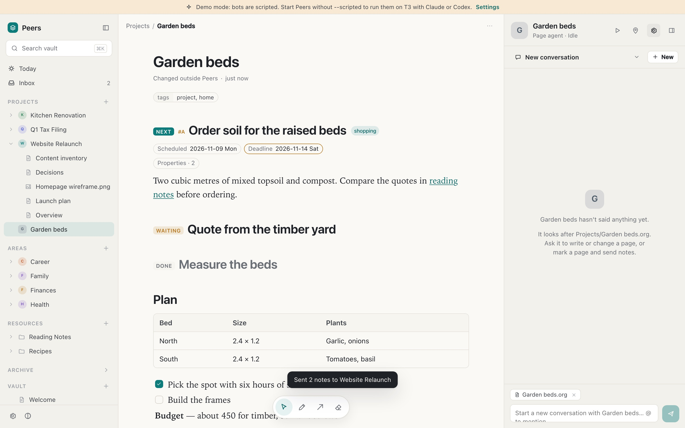 | 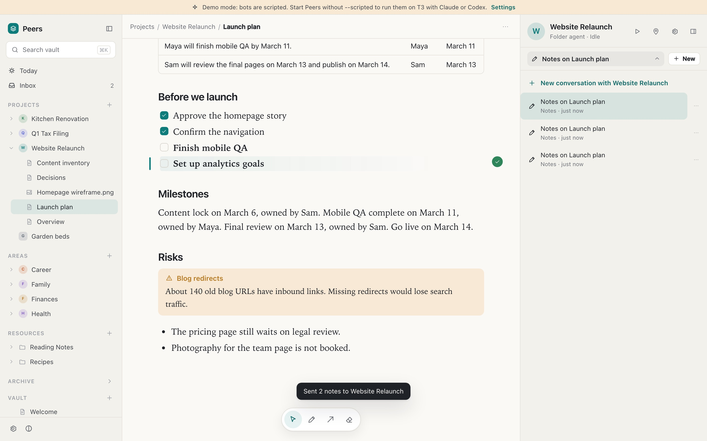 |

| An @mention, in the mentioned agent's chat | Agent settings |
| --- | --- |
| 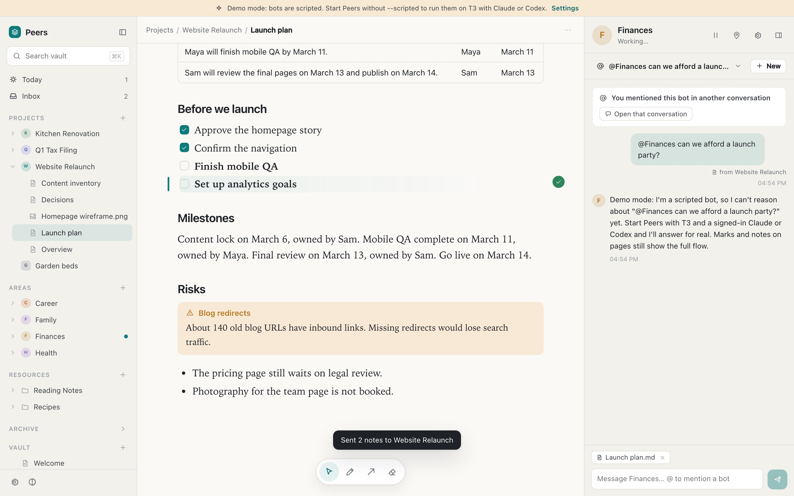 | 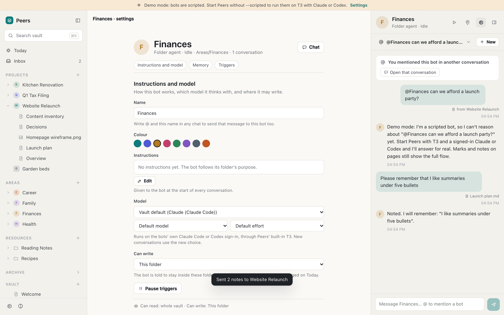 |

| Marking a paragraph, night | Today, night |
| --- | --- |
| 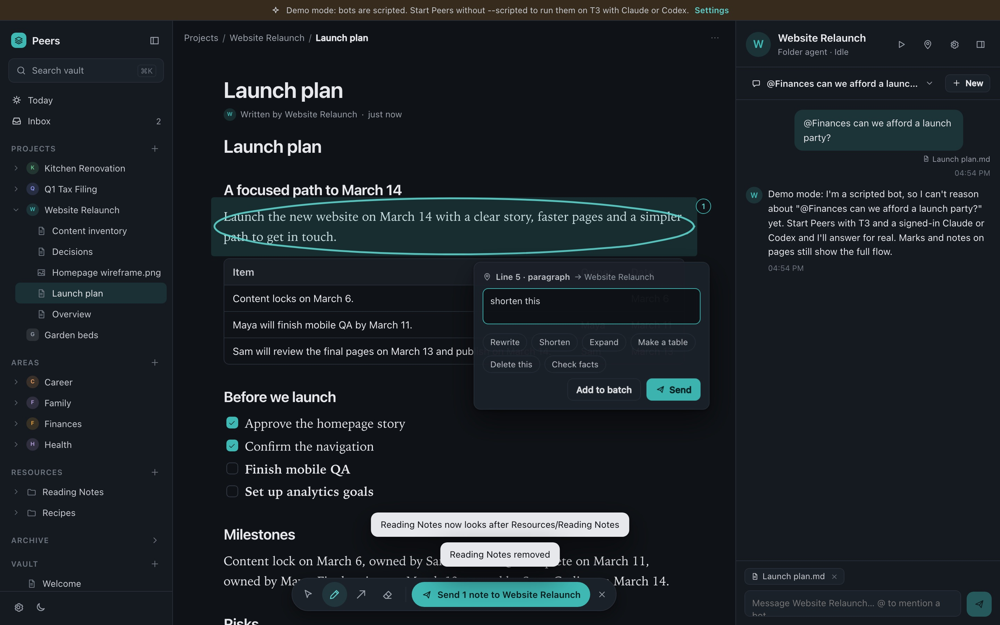 | 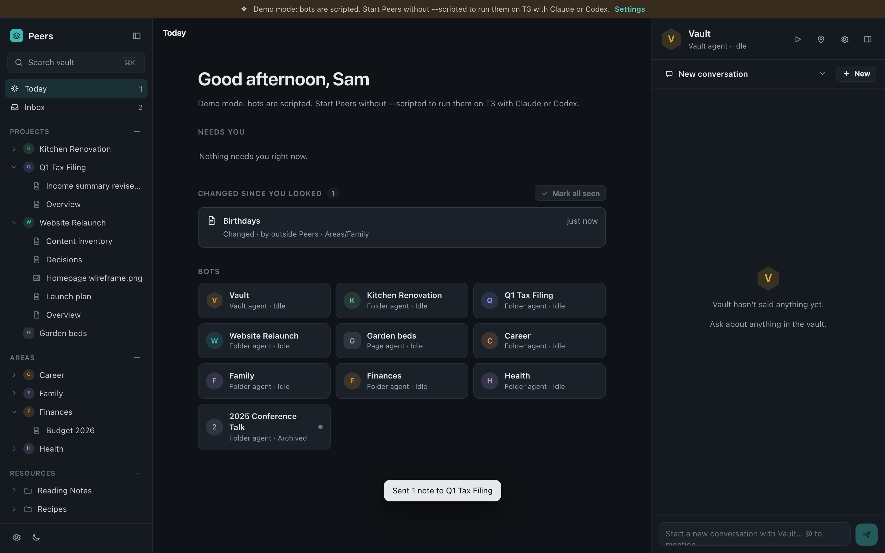 |

| A PDF region note | Reading view |
| --- | --- |
| 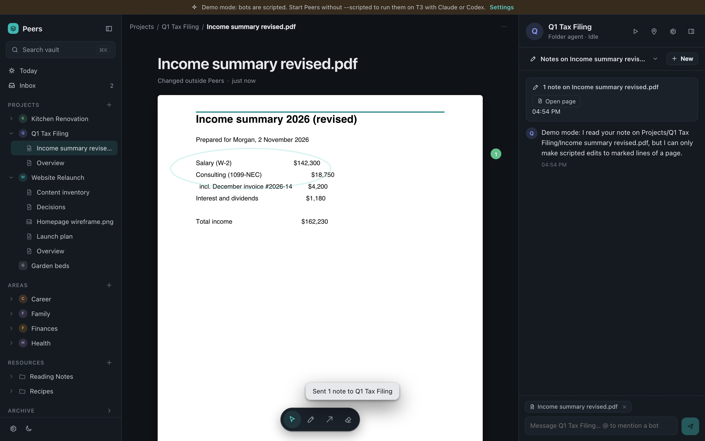 | 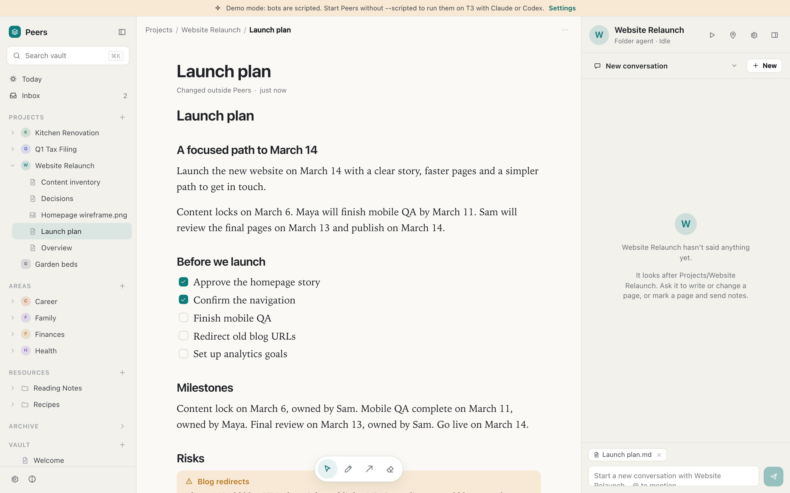 |

| Phone: page and agent sheet | Phone: note | Phone: agent |
| --- | --- | --- |
| 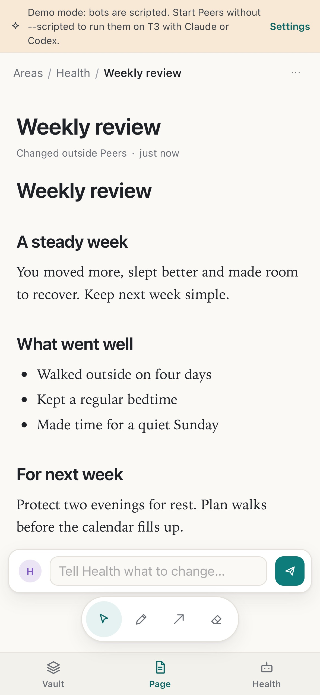 | 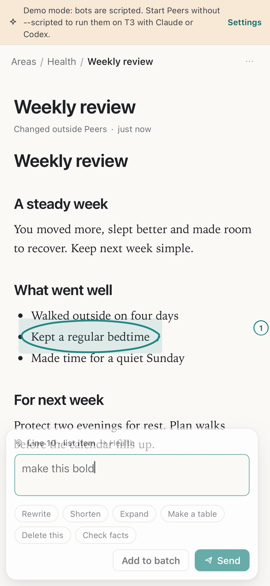 | 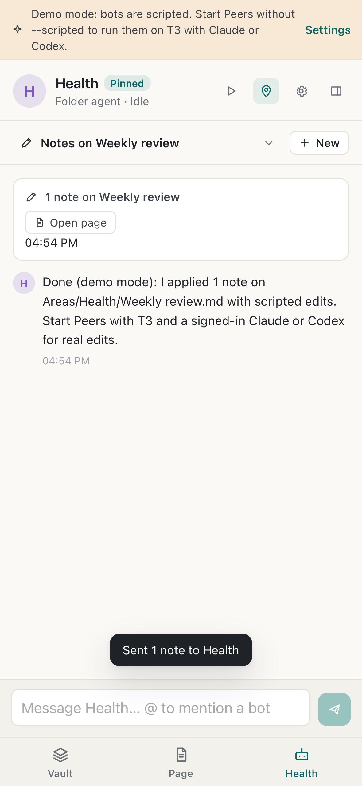 |
